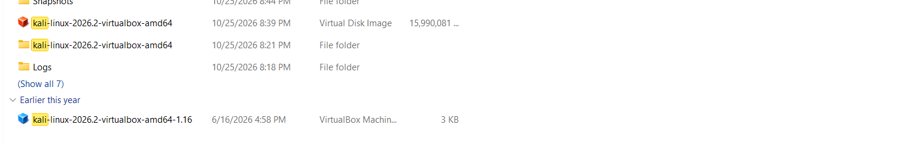

# NETWORKWALKS-FORTUNATE-B083-WK1-PM1-CYBERSECURITY-LAB-SETUP
## WEEK 1 – CYBERSECURITY LAB ENVIRONMENT SETUP

**Task:** WK1-PM1  
**Project:** Cybersecurity Lab Setup  
**Host Operating System:** Windows  
**Virtualisation Software:** Oracle VM VirtualBox 7.2.22  
**Virtual Machine:** Kali Linux 2026.2 (VirtualBox AMD64)  
**Network Configuration:** Custom NAT Network  
**IP Address Requirement:** 10.0.0.2/24

---

## 1. Project Overview

This project documents the preparation and configuration of a virtual cybersecurity lab environment as part of the NetworkWalks Academy Week 1 practical task.

The purpose of this exercise is to establish an isolated virtual environment where Kali Linux can be used as the primary cybersecurity testing machine.

Oracle VM VirtualBox is used to run Kali Linux as a virtual machine on a Windows laptop. A custom NAT Network is required to provide network connectivity and create a structured environment for future practical cybersecurity exercises.

This README serves as a technical record of the setup process, configuration requirements, and supporting screenshot evidence.

## 2. Project Objectives

The main objectives of this practical task are to:

- Prepare the Windows laptop for virtualisation.
- Download and install the required supporting software.
- Install Oracle VM VirtualBox.
- Download and extract the Kali Linux VirtualBox image.
- Prepare Kali Linux as a virtual machine.
- Create a custom NAT Network using the `10.0.0.0/24` subnet.
- Configure Kali Linux to use the required IP address, `10.0.0.2/24`.
- Enable clipboard sharing and drag-and-drop functionality.
- Configure a shared folder between Windows and Kali Linux.
- Verify internet connectivity inside Kali Linux.
- Create a snapshot of the virtual machine.

## 3. Software and Installation Files

The following installation files were downloaded for the lab setup:

| Software | File / Version | Purpose |
|---|---|---|
| Oracle VirtualBox | VirtualBox-7.2.22-175245-Win | Runs virtual machines |
| Kali Linux | kali-linux-2026.2-virtualbox-amd64 | Provides the cybersecurity testing environment |
| 7-Zip | Version to be documented | Supports archive extraction |

### Downloaded Files


The following files were confirmed on the Windows laptop:

**1. Oracle VirtualBox**
- File: `VirtualBox-7.2.22-175245-Win`
- File type: Application
- Purpose: Virtualisation software used to manage and run Kali Linux.

**2. Kali Linux**

- File: `kali-linux-2026.2-virtualbox-amd64`
- File type: Compressed archive
- Purpose: Contains the pre-built Kali Linux VirtualBox virtual machine files.

Kali Linux was located through a Google search and downloaded as a VirtualBox AMD64 archive. The archive was extracted to access the virtual machine files.

> Note: The archive is a pre-built VirtualBox image, not a standard ISO installation file.

## 4. Lab Environment Architecture

The lab uses Windows as the host operating system and Kali Linux as the guest virtual machine.

### Environment Components

- **Host machine:** Windows laptop
- **Virtualisation platform:** Oracle VM VirtualBox
- **Guest operating system:** Kali Linux 2026.2
- **Virtual network:** Custom NAT Network
- **Network subnet:** 10.0.0.0/24
- **Required Kali IP:** 10.0.0.2/24

### Network Configuration Requirements

| Network Setting | Required Configuration |
|---|---|
| Network type | NAT Network |
| Network address | 10.0.0.0 |
| Subnet mask | 255.255.255.0 |
| CIDR notation | /24 |
| Kali Linux IP | 10.0.0.2 |
| Suggested gateway | 10.0.0.1 |
| Broadcast address | 10.0.0.255 |

The actual gateway and DHCP configuration must be checked against the VirtualBox NAT Network settings.

The DHCP range should not assign `10.0.0.2` to another device if that address is configured statically for Kali Linux.

## 5. Implementation Process

### Step 1: Prepare the Windows Environment

The Windows laptop was used as the host machine for the virtual cybersecurity lab.

The required software installation files were downloaded and organised in preparation for the setup process.

**Evidence:** `01-downloaded-files.png`

### Step 2: Download and Install Oracle VirtualBox

Oracle VM VirtualBox version 7.2.22 was downloaded.

The installer file was:

`VirtualBox-7.2.22-175245-Win`

VirtualBox provides the virtualisation platform required to create and manage the Kali Linux virtual machine.

**Evidence:** `02-virtualbox-installation.png`

### Step 3: Download and Extract Kali Linux

Kali Linux 2026.2 VirtualBox AMD64 was downloaded as a compressed archive.

The downloaded file was:

`kali-linux-2026.2-virtualbox-amd64`

The archive was extracted to access the pre-built virtual machine files.

The extracted files are used to prepare Kali Linux in VirtualBox.

**Evidence:** `03-kali-extracted-files.png`

### Step 4: Prepare Kali Linux in VirtualBox

The extracted Kali Linux VirtualBox files are used to add the virtual machine to Oracle VirtualBox.

The virtual machine must be configured with suitable memory, processor, and network settings according to the laptop's available resources.

**Evidence:** `04-kali-virtual-machine.png`

### Step 5: Create a Custom NAT Network

A custom NAT Network must be created in VirtualBox.

The required network configuration is:

- Network type: NAT Network
- Network address: `10.0.0.0/24`
- Subnet mask: `255.255.255.0`

The Kali Linux virtual machine must be connected to this NAT Network.

**Evidence:** `05-nat-network-configuration.png`

### Step 6: Configure Kali Linux IP Address

Kali Linux must use the IP address specified in the practical task:

`10.0.0.2/24`

The network configuration should be checked inside Kali Linux to confirm that the correct address has been assigned.

**Evidence:** `06-kali-ip-configuration.png`

### Step 7: Configure Clipboard and Drag-and-Drop

The VirtualBox settings must be configured to support communication between the Windows host and Kali Linux guest.

Required settings:

- Shared Clipboard: Bidirectional
- Drag and Drop: Bidirectional

These settings allow supported text and file-transfer operations between the two environments.

**Evidence:** `07-clipboard-drag-drop.png`

### Step 8: Configure a Shared Folder

A shared folder must be configured between Windows and Kali Linux.

The host folder specified in the task is:

`Downloads`

The folder should be configured in VirtualBox under the Kali Linux virtual machine's Shared Folders settings.

Enable the appropriate options, including Auto-mount where required.

**Evidence:** `08-shared-folder-configuration.png`

### Step 9: Verify Internet Connectivity

Kali Linux must have internet access through the configured NAT Network.

Connectivity should be tested from inside the Kali Linux terminal.

Example commands:

```bash
ip addr
```

```bash
ping -c 4 8.8.8.8
```

```bash
ping -c 4 google.com
```

The first command checks network interface information. The other commands test external IP connectivity and DNS resolution.

**Evidence:** `09-internet-connectivity.png`

### Step 10: Create a Virtual Machine Snapshot

After completing and verifying the required configuration, create a snapshot of the Kali Linux virtual machine.

The snapshot provides a restore point that can be used if future lab activities cause configuration problems.

Suggested snapshot name:

`Week 1 - Kali Linux Lab Setup`

**Evidence:** `10-kali-snapshot.png`

## 6. Troubleshooting Reference

The practical task includes a possible network connectivity issue affecting some VirtualBox 7 and Kali Linux versions.

If the specified issue occurs, the following commands are provided as a troubleshooting reference:

```bash
sudo nmcli connection modify "Wired connection 1" ipv4.dad-timeout 0
```

```bash
sudo nmcli connection down "Wired connection 1"
```

```bash
sudo nmcli connection up "Wired connection 1"
```

These commands should only be used when applicable to the actual network connection and troubleshooting symptoms.

## 7. Screenshot Evidence

All practical evidence for this task should be captured directly from the Windows laptop and Kali Linux virtual machine.

The screenshots are organised in the `screenshots` folder.

| No. | Screenshot | Evidence |
|---|---|---|
| 01 | Downloaded files | VirtualBox and Kali Linux download files |
| 02 | VirtualBox installation | VirtualBox installation or application |
| 03 | Kali extracted files | Extracted Kali Linux VirtualBox files |
| 04 | Kali virtual machine | Kali Linux VM in VirtualBox |
| 05 | NAT Network configuration | Custom 10.0.0.0/24 network |
| 06 | Kali IP configuration | Kali Linux IP address |
| 07 | Clipboard and drag-and-drop | VirtualBox integration settings |
| 08 | Shared folder configuration | Windows Downloads folder shared with Kali |
| 09 | Internet connectivity | Successful connectivity test |
| 10 | Kali snapshot | Created VirtualBox snapshot |

## 8. Additional Practical Work

The Week 1 task also introduces the possibility of adding additional virtual machines and testing communication between them.

These activities are considered additional or optional unless specifically required by the instructor.

The current project focuses on the Windows host, Oracle VirtualBox, and Kali Linux environment.

## 9. Expected Learning Outcomes

Through this practical task, the following skills are developed:

- Understanding virtualisation and virtual machine management.
- Preparing a cybersecurity testing environment.
- Working with Kali Linux.
- Understanding NAT Network configuration.
- Applying basic IP addressing concepts.
- Configuring host-to-guest integration.
- Testing internet connectivity.
- Creating and managing virtual machine snapshots.
- Documenting technical procedures and evidence.

## 10. Conclusion

The Week 1 practical task introduces the foundation of building a virtual cybersecurity lab environment.

Using Oracle VM VirtualBox and Kali Linux, the project establishes the components needed for future cybersecurity learning and practical testing.

The README provides a structured record of the software, network requirements, implementation process, troubleshooting reference, and screenshot evidence.

The completion of each configuration step should be supported by genuine screenshots captured from the actual lab environment.

---

**Project:** Cybersecurity Lab Setup  
**Task:** WK1-PM1  
**Environment:** Windows + Oracle VirtualBox + Kali Linux  
**Repository:** Week 1 Cybersecurity Lab Setup
